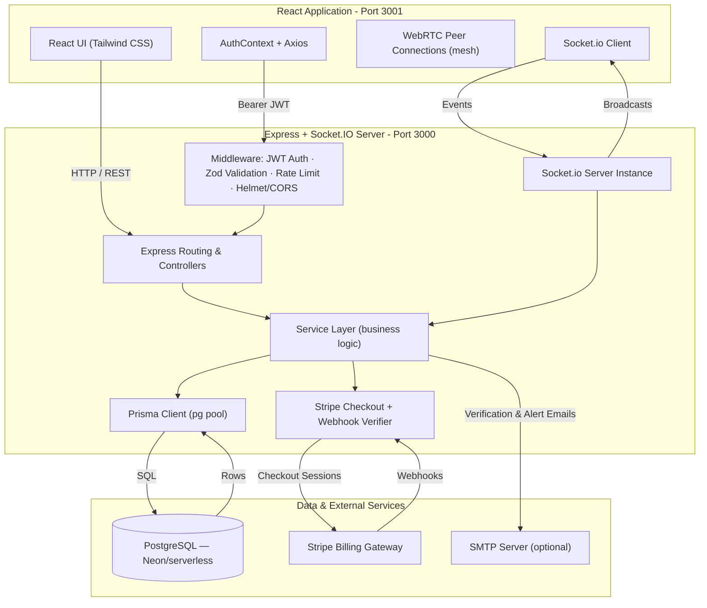
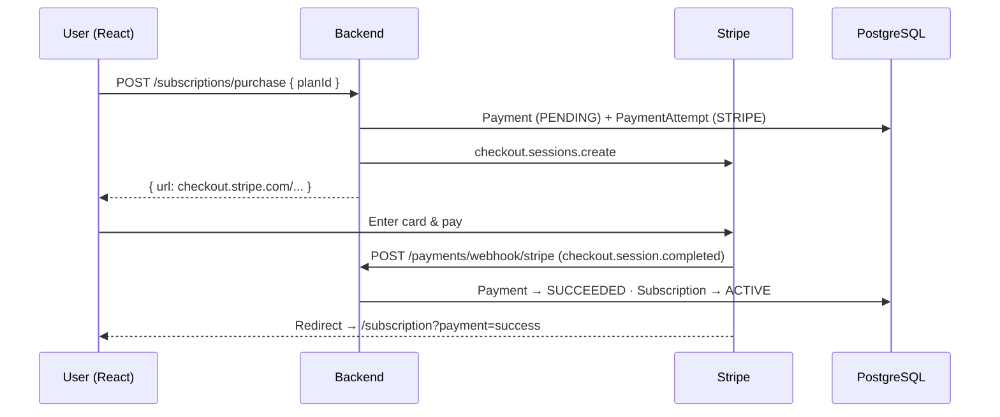

# 🎙️ PodcastHub — Rebuilt Backend

A modern, full-stack, real-time podcasting and subscription platform backend. Built with **TypeScript + Express 5 + Prisma + PostgreSQL**, it provides JWT authentication, role-based access (user / host / admin), WebRTC-based live sessions (no Agora), real-time chat over Socket.IO, session recordings, collaboration tools (interview, whiteboard, code editor, webinar, polls, Q&A), and Stripe-powered subscription billing.

---

## 🏗️ System Architecture



### Request lifecycle

```
Client → Helmet/CORS → rate limiter → JWT auth → Zod validation
       → Controller → Service → Prisma → PostgreSQL
       → serialized response (legacy snake_case aliases preserved)
```

---

## ✨ Core Features

*   **🔐 Authentication & Users**
    *   Register / login / forgot & reset password / email verification
    *   JWT access tokens, bcrypt password hashing, role claims (`user`, `host`, `admin`)
    *   Profile management + avatar uploads (`/uploads`)

*   **🎙️ Live Sessions (WebRTC, no Agora)**
    *   Hosts & admins create, schedule, start, end, and delete sessions
    *   Full-mesh WebRTC video between participants (offer/answer + ICE via Socket.IO)
    *   Roles: host, speaker, listener — deterministic offerer to avoid glare
    *   Join/leave tracking, viewer counts, scheduled/ended/cancelled states
    *   Admin moderation: manage **any** session, force-end live sessions

*   **💬 Real-time Chat (Socket.IO)**
    *   JWT-authenticated socket handshake
    *   Room-scoped messages persisted to Postgres, history endpoint
    *   Typing indicators, join/leave notifications, self-healing membership

*   **💳 Plans, Subscriptions & Stripe Billing**
    *   Multi-tier plans managed by admins (CRUD at `/admin`)
    *   Free plan instant activation; premium plans → **Stripe Checkout** redirect
    *   Webhook (`checkout.session.completed`) → payment `SUCCEEDED` + subscription `ACTIVE`
    *   Payment + PaymentAttempt audit trail with idempotency keys
    *   Renew / cancel subscriptions; user subscription sync (`subscription_type`, `subscription_status`)

*   **📼 Recordings**
    *   Host-controlled recording toggle per session, recording list/download per user & session

*   **🧩 Collaboration Modules**
    *   Interview rooms, whiteboard, collaborative code editor
    *   Webinar tools: polls, Q&A, moderation controls

---

## 🛠️ Tech Stack

### Backend (`rebuilt/`)
*   **Node.js** + **TypeScript** (ESM, `tsx` dev runner)
*   **Express 5** — REST API
*   **Prisma 7** + **pg** — PostgreSQL access with connection pooling
*   **Socket.IO** — real-time events & WebRTC signaling
*   **Stripe Node SDK** — Checkout Sessions + webhook signature verification
*   **Zod** — request validation
*   **JWT + bcrypt** — authentication
*   **Helmet, CORS, express-rate-limit, pino** — security & observability
*   **Multer** — file uploads
*   **Jest** — tests

### Frontend (`frontend/`)
*   **React 18** SPA — React Router v6, Axios, Socket.IO client
*   **WebRTC** (`navigator.mediaDevices`) for camera/mic/screen share
*   Tailwind-style utility classes, `react-hot-toast`, `lucide-react`

---

## 📂 Project Structure

```
podcast/
├── backend/                  # Legacy MongoDB/Agora backend (reference only)
├── rebuilt/                  # ⭐ This backend — TypeScript/Prisma/PostgreSQL
│   ├── prisma/
│   │   ├── schema.prisma     # Full data model (users, plans, payments,
│   │   │                     #   subscriptions, sessions, participants,
│   │   │                     #   recordings, chat, interview, webinar…)
│   │   └── migrations/
│   ├── src/
│   │   ├── config/           # External service clients (payment service)
│   │   ├── controllers/      # HTTP handlers (thin)
│   │   ├── gateways/         # Payment gateway adapters
│   │   ├── lib/              # prisma.ts (pool + keep-alive + error handler)
│   │   ├── middleware/       # auth, authorize, validate, security, errors
│   │   ├── routes/           # One router per domain
│   │   ├── services/         # Business logic layer
│   │   ├── socket/           # session.socket.ts, chat.socket.ts
│   │   ├── types/            # Shared TypeScript types
│   │   ├── utils/            # AppError, asyncHandler, token, mail
│   │   └── validation/       # Zod schemas
│   ├── .env
│   └── README.md
└── frontend/                 # React SPA (adapted to this backend)
    └── src/
        ├── components/       # Auth, Layout, Chat, ParticipantGrid, VideoPlayer…
        ├── context/          # AuthContext
        ├── pages/            # Home, Sessions, SessionView, Subscription, AdminPlans…
        ├── services/         # api.js (Axios), socket.js, webrtc.js
        └── App.jsx
```

---

## 🚀 Installation & Local Setup

### Prerequisites
*   Node.js ≥ 18
*   PostgreSQL (Neon serverless URI works great for dev)
*   Stripe account with **test keys**
*   Stripe CLI (optional, for local webhooks)

### 1. Backend

```bash
cd rebuilt
npm install
cp .env.example .env   # or create manually — see table below
npx prisma migrate deploy
npm run dev            # http://localhost:3000
```

### 2. Frontend

```bash
cd frontend
npm install
npm start              # http://localhost:3001
```

Frontend `.env`:

```env
REACT_APP_API_URL=http://localhost:3000/api/v1
```

### Environment Variables (`rebuilt/.env`)

| Variable | Purpose |
|---|---|
| `DATABASE_URL` | PostgreSQL connection string |
| `JWT_SECRET` | JWT signing secret |
| `PORT` | Server port (default `3000`) |
| `NODE_ENV` | `development` / `production` |
| `BASE_URL` `FRONTEND_URL` `FRONTEND_URI` | CORS origins + Stripe redirect base (`http://localhost:3001`) |
| `ADMIN_EMAIL` `ADMIN_PASSWORD` | Seeded admin account |
| `MAIL_HOST` `MAIL_PORT` `MAIL_USERNAME` `MAIL_PASSWORD` | SMTP (optional — emails skipped if unset) |
| `STRIPE_SECRET_KEY` | `sk_test_...` |
| `STRIPE_WEBHOOK_SECRET` | `whsec_...` from Stripe CLI |
| `PAYMENT_SERVICE_MOCK` | `true` → mock the legacy payment microservice |
| `PAYMENT_SERVICE_URL` `PAYMENT_SERVICE_API_KEY` `PAYMENT_SERVICE_TIMEOUT_MS` | External payment service (ignored when mocking) |

---

## 📡 REST API Overview

Base: `/api/v1` — auth via `Authorization: Bearer <jwt>` unless noted.

| Module | Key Endpoints | Access |
|---|---|---|
| **Auth** | `POST /auth/register` · `/login` · `/forgot-password` · `/reset-password` | Public |
| **Users** | `GET /users/profile` · profile update · avatar upload | JWT |
| **Plans** | `GET /plans` · `POST /plans` · `PUT /plans/:id` · `DELETE /plans/:id` | Read public; write **admin** |
| **Subscriptions** | `POST /createFreeSubscription/:userId` · `POST /purchase` (Stripe) · `GET /getUserSubscription` · `PUT /renewSubscription/:id` · `PUT /cancelSubscription/:id` · activate/deactivate/upgrade | Mixed |
| **Payments** | `GET /payments/history` · `GET /payments/status/:txn` · `POST /payments/create` · `POST /payments/process-subscription` (mock) · `POST /payments/checkout` · `POST /payments/webhook/stripe` (raw body) · `GET /payments/all` | JWT / admin |
| **Sessions** | `POST /sessions/create` · `GET /sessions` · `GET /sessions/:id` · `PUT/DELETE /sessions/:id` · `POST /:id/join` · `/:id/start` · `/:id/end` · `/:id/leave` · `/:id/toggle-recording` · `/:id/toggle-screen-share` | host+admin for management |
| **Recordings** | `/recordings/*` — start/stop/list/download | JWT |
| **Chat** | `/chat/*` history + send/delete | session members |
| **Collaboration** | `/interview/*` · `/webinar/*` · whiteboard · code-editor · polls · Q&A | JWT |

---

## 💳 Stripe Payment Flow



Local webhook forwarding:

```bash
stripe listen --forward-to localhost:3000/api/v1/payments/webhook/stripe
# copy the printed whsec_... into STRIPE_WEBHOOK_SECRET, restart backend
```

Test card: `4242 4242 4242 4242` — any future expiry, any CVC.

---

## 🔌 Socket.IO Events

Connect to `http://localhost:3000` (JWT in auth). Session room = `sessionId`.

### Client → Server
| Event | Payload | Purpose |
|---|---|---|
| `join-session` | `{ sessionId }` | Join room, get `session-state` |
| `send-message` | `{ sessionId, message, type }` | Persist + broadcast chat |
| `typing-start` / `typing-stop` | `{ sessionId }` | Typing indicators |
| `webrtc-offer` / `webrtc-answer` / `webrtc-ice-candidate` | signaling payloads | Full-mesh peer setup |

### Server → Client
| Event | Purpose |
|---|---|
| `session-state` | Room snapshot on join (confirms membership) |
| `user-joined` / `user-left` | Participant notifications |
| `new-message` / `receive-message` | Chat delivery |
| `user-typing` | `{ userId, userName, isTyping }` |
| `session-ended` | Host/admin ended the session |

---

## 🧪 Scripts

```bash
npm run dev        # tsx watch (dev)
npm run build      # tsc → dist/
npm start          # node dist/index.js
npm test           # jest
npx prisma studio  # DB GUI
npx prisma migrate dev|deploy|status
```

---

## ⚠️ Troubleshooting

*   **`Payment mock is enabled in production`** — `PAYMENT_SERVICE_MOCK=true` requires `NODE_ENV=development`.
*   **`invalid input value for enum "PaymentStatus": "SUCCEEDED"`** — DB enum is stale; run `prisma/fix_payment_status_enum.sql` via `npx prisma db execute --file ...`.
*   **`Connection terminated unexpectedly` (Neon)** — idle connections dropped by serverless Postgres; handled by the pool `error` listener — retry the request.
*   **Stripe webhook `Signature verification failed`** — the webhook route is mounted **before** `express.json()` to preserve the raw body; don't reorder, and set `STRIPE_WEBHOOK_SECRET`.
*   **CORS errors from `localhost:3001`** — add the origin to `BASE_URL`/`FRONTEND_URL`/`FRONTEND_URI` in `.env`.

---

## 📄 License

MIT
